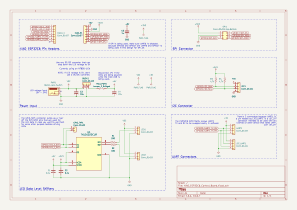
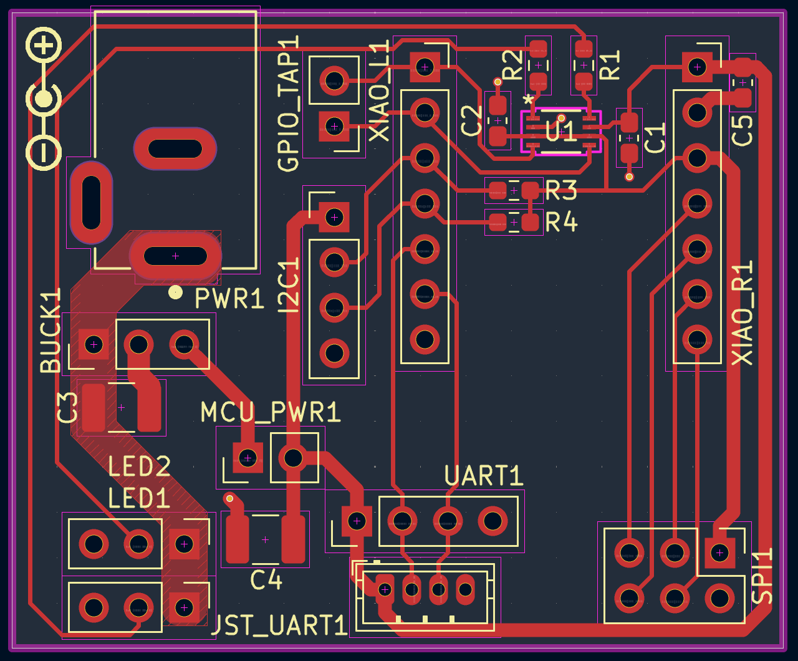
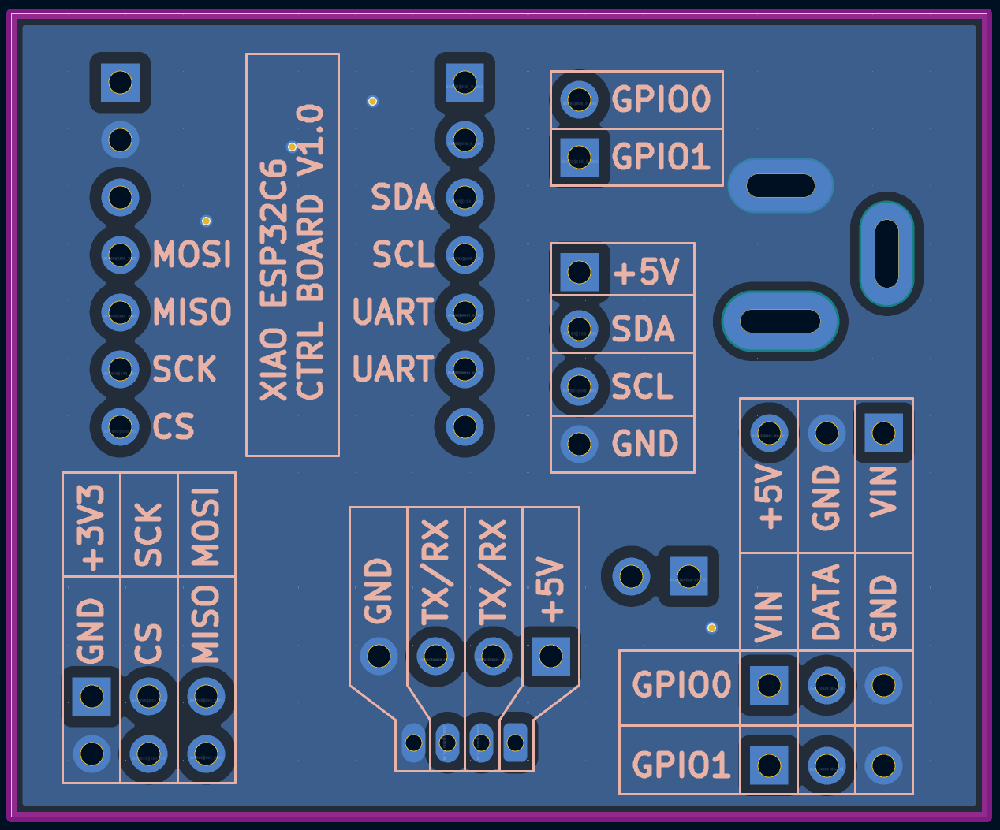
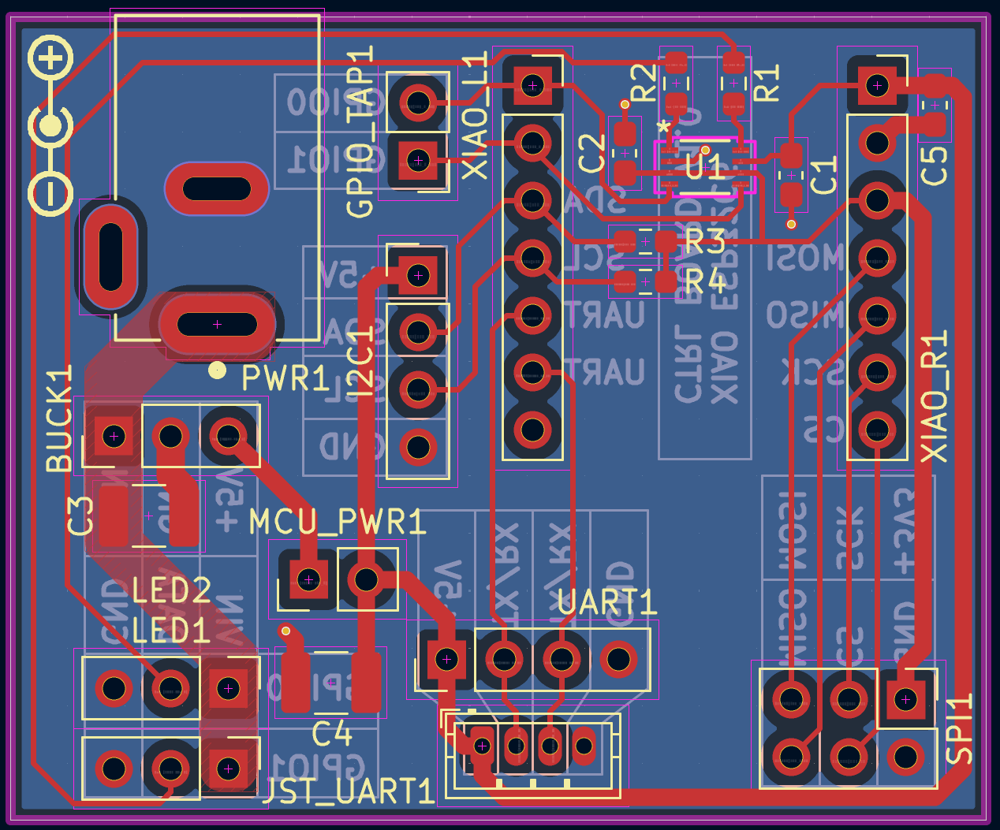
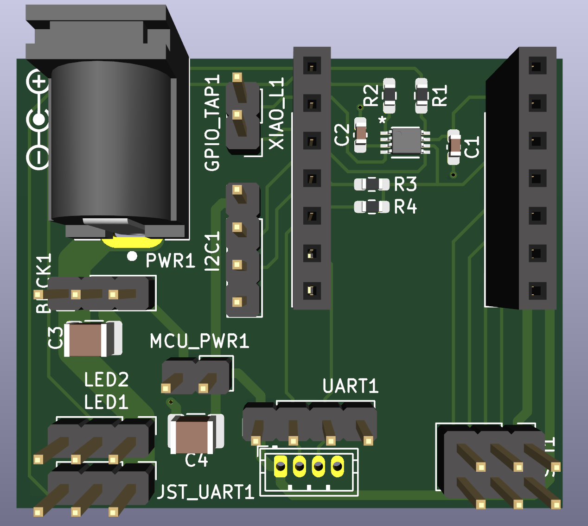

# Overview
This is a "generic" breakout board for the XIAO ESP32C6. Generic is in quotes because the board is primarily designed to be an addressable LED strip controller.

However, the board is designed in a way where the peripherals can be used for other purposes. This allows the same board to be used with other XIAO ESP32C6 projects.

# Features
1. Dual 3.3V -> 5V level shifter for addressable LED data
2. Onboard pullups for I2C data and clock
3. Power jumper to allow the XIAO to be powered via USB while the barrel jack is plugged in
   - This is needed since the XIAO doesn't have onboard power or-ing for the 5V input and V_USB rail
4. Connector for off-board buck converter
5. Dual connectors for UART: one for standard 2.54 mm headers and one for a 1.5 mm pitch JST connector

# Layer Stackup
This is a 2-layer board with the following stackup:

1. Signal + Power
2. Ground

This is a very simple board with relatively low speed signals so I didn't bother with a 4-layer board

# Images
## Schematic

## PCB
### Top Layer

### Bottom Layer

### Top + Bottom Layer

## 3D View

